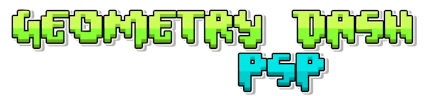
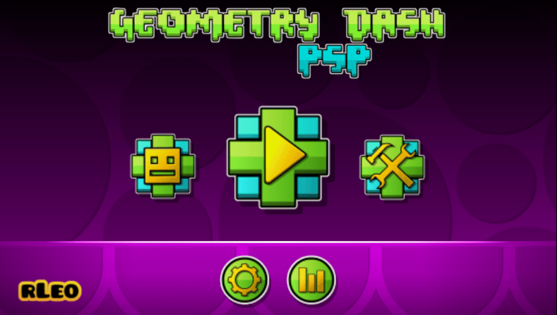
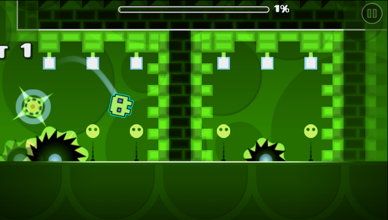
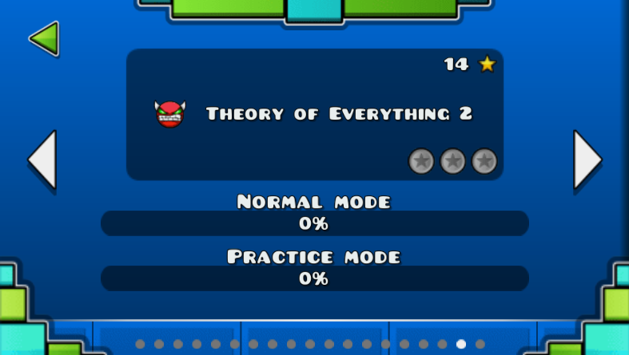
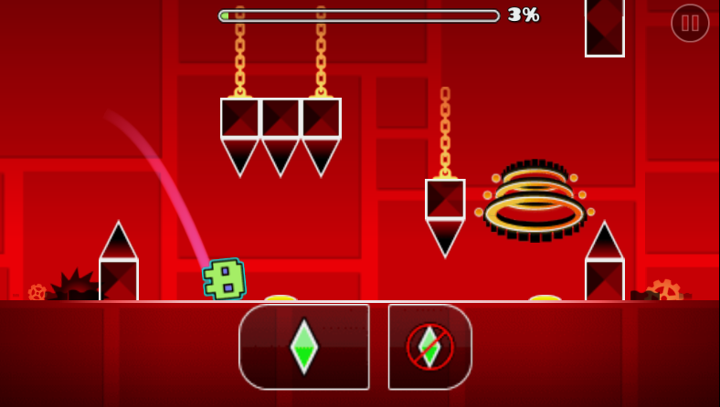
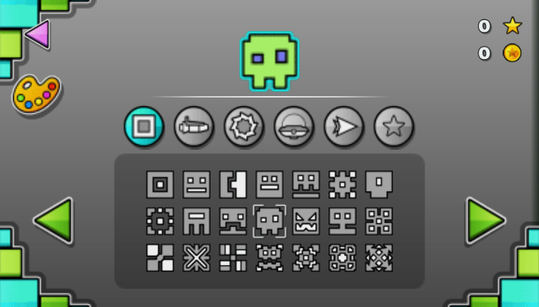

<p align="center">
  
</p>

<p align="center">
  A port of <b>Geometry Dash</b> to the <b>Sony PSP</b>, based on <a href="https://github.com/AleFunky/gd3ds">GD3DS</a> by AleFunky.<br>
  Un port de <b>Geometry Dash</b> para <b>Sony PSP</b>, basado en <a href="https://github.com/AleFunky/gd3ds">GD3DS</a> de AleFunky.
</p>

<p align="center">
  <a href="#english">English</a> · <a href="#español">Español</a>
</p>

<p align="center">
  
  
</p>
<p align="center">
  
  
</p>
<p align="center">
  
</p>

> Geometry Dash and all of its assets belong to **RobTop Games**. This is a non-commercial fan project, not affiliated with or endorsed by RobTop Games. If you enjoy it, please support the original game.

---

## English

### About

Geometry Dash PSP brings AleFunky's Nintendo 3DS version of Geometry Dash ([GD3DS](https://github.com/AleFunky/gd3ds)) to the PSP. The game code is GD3DS's, almost untouched: the PSP side recreates the 3DS libraries it uses (libctru, citro2d, citro3d) on top of the PSP SDK, and the two 3DS screens were redesigned to fit on the PSP's single 480x272 screen.

### Features

- All the main levels, from Stereo Madness to Theory of Everything 2, plus Geometrical Dominator and Deadlocked
- **GD 2.0 support** (based on AleFunky's [wiidash](https://github.com/AleFunky)): robot, teleport portals, 2.0 objects, groups and the Move, Alpha, Toggle, Spawn and Pulse triggers
- Accurate physics, particles, player trails and level coins
- Practice mode, with auto-checkpoints on by default
- Custom levels (up to GD 2.0) loaded from the Memory Stick
- Icon kit (with robots), settings, progress and statistics, all saved on the Memory Stick
- Every menu redesigned for one 480x272 screen
- 30 FPS by default, with a **60 FPS Switch** option in the settings
- Music decoded on the PSP's Media Engine
- Runs on **every PSP model, including the PSP-1000**, and on PPSSPP

Not included: online features, the level editor, and GD 2.1+ objects and triggers.

### Installation

You need a PSP with custom firmware (for example 6.61 PRO-C, LME or ARK-4) and about 40 MB free on the Memory Stick.

1. Download the zip from [Releases](../../releases/latest).
2. Extract it to the root of the Memory Stick. It contains `PSP\GAME\GeometryDashPSP\`, with `EBOOT.PBP` and the `romfs` folder inside.
3. On the PSP, go to **Game > Memory Stick** and open **Geometry Dash PSP**.

The first time it starts, the game creates a `mstick` folder next to the EBOOT, where it keeps your progress and settings. Delete that folder to start from scratch.

### Custom levels

1. Start the game once, so its folders get created.
2. Get the level as a `.gmd` file, for example with the [GDShare](https://geode-sdk.org/mods/hjfod.gdshare) mod or from [GDHistory](https://history.geometrydash.eu/).
3. Copy it to `PSP\GAME\GeometryDashPSP\mstick\psp\gdpsp\external_levels\`.
4. If it uses a custom song, copy the `.mp3` to `...\mstick\psp\gdpsp\saved_songs\`, named after its Newgrounds ID (for example `467339.mp3`). Use MP3s at 128 kbps of no more than 8 MB: bigger ones may not load on a PSP, which has little memory.
5. In the game: **Creator** (the tools button) > **Custom**.

GD 2.0 levels are supported (robot, teleport portals, groups and the Move, Alpha, Toggle, Spawn and Pulse triggers). Levels that use GD 2.1 or 2.2 features (spider, newer triggers) may not work properly, and very object-heavy levels may run slowly.

### Controls

| Button | Action |
|---|---|
| Cross | Jump / press the selected button |
| Circle | Back (on the main menu: quit the game) |
| Start | Pause |
| D-pad / analog stick | Move between buttons in the menus |

### Troubleshooting

The game writes `psp_log.txt` next to the EBOOT. If it crashes, copy that file **before** starting the game again (every start overwrites it) and open an [issue](../../issues) with it and with what you were doing at the time.

### Building

You need the [PSP toolchain](https://github.com/pspdev/pspdev) (`PSPDEV` set and its `bin` in `PATH`) and Python 3 with Pillow built with libimagequant support (Debian/Ubuntu's `python3-pil` is).

```
make -f Makefile.psp package                       # psp/out/gdpsp/: EBOOT.PBP + romfs/
make -f Makefile.psp deploy DEPLOY=/path/to/folder  # copy it to a folder (a Memory Stick, PPSSPP...)
```

[README-PSP.md](README-PSP.md) explains how the port is organized. The original 3DS README is in [README-3DS.md](README-3DS.md).

### Credits

- **RobTop Games**: Geometry Dash and all of its assets.
- **AleFunky** and the GD3DS contributors: [GD3DS](https://github.com/AleFunky/gd3ds), the 3DS version this port is based on.
- **camila314**: the physics from Pathfinder, used by GD3DS.
- **rLeo**: PSP port.
- **Claude** (Anthropic): collaborator on the PSP port.
- **pspdev**: the PSP toolchain and SDK.

---

## Español

### Qué es

Geometry Dash PSP lleva a la PSP la versión de Geometry Dash para Nintendo 3DS hecha por AleFunky ([GD3DS](https://github.com/AleFunky/gd3ds)). El código del juego es el de GD3DS, casi sin cambios: del lado de la PSP se recrean las librerías de 3DS que usa (libctru, citro2d, citro3d) sobre el SDK de PSP, y las dos pantallas de la 3DS se rediseñaron para entrar en la única pantalla de 480x272 de la PSP.

### Características

- Todos los niveles principales, de Stereo Madness a Theory of Everything 2, más Geometrical Dominator y Deadlocked
- **Soporte de GD 2.0** (basado en [wiidash](https://github.com/AleFunky), de AleFunky): robot, portales de teletransporte, objetos de la 2.0, grupos y los triggers Move, Alpha, Toggle, Spawn y Pulse
- Física precisa, partículas, estelas del jugador y monedas
- Modo práctica, con checkpoints automáticos activados por defecto
- Niveles custom (hasta GD 2.0) cargados desde la Memory Stick
- Icon kit (con robots), opciones, progreso y estadísticas, todo guardado en la Memory Stick
- Todos los menús rediseñados para una sola pantalla de 480x272
- 30 FPS por defecto, con la opción **60 FPS Switch** en los ajustes
- Música decodificada en el Media Engine de la PSP
- Funciona en **todos los modelos de PSP, incluida la PSP-1000**, y en PPSSPP

No incluye: funciones online, el editor de niveles, ni objetos y triggers de GD 2.1 en adelante.

### Instalación

Necesitás una PSP con custom firmware (por ejemplo 6.61 PRO-C, LME o ARK-4) y unos 40 MB libres en la Memory Stick.

1. Descargá el zip desde [Releases](../../releases/latest).
2. Descomprimilo en la raíz de la Memory Stick. Trae `PSP\GAME\GeometryDashPSP\`, con `EBOOT.PBP` y la carpeta `romfs` adentro.
3. En la PSP, andá a **Juego > Memory Stick** y abrí **Geometry Dash PSP**.

La primera vez que arranca, el juego crea una carpeta `mstick` al lado del EBOOT, donde guarda el progreso y las opciones. Para empezar de cero, borrá esa carpeta.

### Niveles custom

1. Abrí el juego una vez para que se creen sus carpetas.
2. Conseguí el nivel como archivo `.gmd`, por ejemplo con el mod [GDShare](https://geode-sdk.org/mods/hjfod.gdshare) o desde [GDHistory](https://history.geometrydash.eu/).
3. Copialo a `PSP\GAME\GeometryDashPSP\mstick\psp\gdpsp\external_levels\`.
4. Si usa una canción custom, copiá el `.mp3` a `...\mstick\psp\gdpsp\saved_songs\`, con el ID de Newgrounds como nombre (por ejemplo `467339.mp3`). Usá MP3 a 128 kbps de 8 MB como máximo: los más grandes pueden no cargar en la PSP, que tiene poca memoria.
5. En el juego: **Creator** (el botón de herramientas) > **Custom**.

Los niveles de GD 2.0 están soportados (robot, portales de teletransporte, grupos y los triggers Move, Alpha, Toggle, Spawn y Pulse). Los que usan cosas de GD 2.1 o 2.2 (spider, triggers nuevos) pueden no funcionar bien, y los niveles con muchísimos objetos pueden ir lentos.

### Controles

| Botón | Acción |
|---|---|
| Cruz | Saltar / apretar el botón seleccionado |
| Círculo | Volver (en el menú principal: salir del juego) |
| Start | Pausa |
| Cruceta / stick | Moverse entre los botones de los menús |

### Si algo falla

El juego escribe `psp_log.txt` al lado del EBOOT. Si se cuelga, copiá ese archivo **antes** de volver a abrir el juego (cada arranque lo pisa) y abrí un [issue](../../issues) con el archivo y con lo que estabas haciendo en ese momento.

### Compilar

Necesitás el [toolchain de PSP](https://github.com/pspdev/pspdev) (`PSPDEV` configurado y su `bin` en el `PATH`) y Python 3 con Pillow compilado con soporte para libimagequant (el `python3-pil` de Debian/Ubuntu lo trae).

```
make -f Makefile.psp package                        # psp/out/gdpsp/: EBOOT.PBP + romfs/
make -f Makefile.psp deploy DEPLOY=/ruta/a/carpeta   # lo copia a una carpeta (Memory Stick, PPSSPP...)
```

[README-PSP.md](README-PSP.md) explica cómo está organizado el port. El README original de la versión de 3DS está en [README-3DS.md](README-3DS.md).

### Créditos

- **RobTop Games**: Geometry Dash y todos sus recursos.
- **AleFunky** y quienes colaboraron en GD3DS: [GD3DS](https://github.com/AleFunky/gd3ds), la versión de 3DS en la que se basa este port.
- **camila314**: la física de Pathfinder, que usa GD3DS.
- **rLeo**: port a PSP.
- **Claude** (Anthropic): colaborador en el port a PSP.
- **pspdev**: el toolchain y el SDK de PSP.
